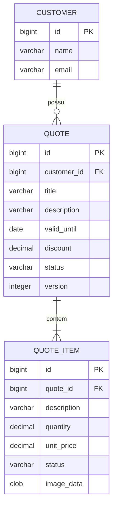
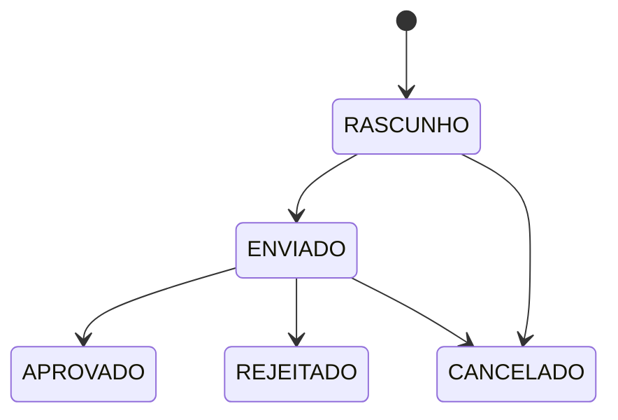

# Arquitetura e modelo de dados

O projeto usa uma interface HTML/CSS/JavaScript servida pelo mesmo aplicativo Java da API. A separação segue as responsabilidades de MVC: a interface apresenta os dados, os controllers recebem solicitações e o modelo representa o domínio. Services concentram regras/transações e repositories executam SQL.

## Dados

O banco cria chaves, índices e restrições a partir de `schema.sql`, que também adiciona colunas novas às bases H2 existentes. A exigência de pelo menos um item é garantida na aplicação; a chave estrangeira sozinha não impõe a cardinalidade mínima. O total é derivado dos itens e do desconto, sem coluna redundante de total.

## Estados

## Decisões

- **JDBC em vez de ORM:** explicitar SQL, chaves e transações para o trabalho de banco.
- **H2 em arquivo:** permitir execução local sem instalar outro servidor. Testes usam H2 em memória.
- **BigDecimal:** trabalhar com valores decimais e uma regra explícita de arredondamento.
- **Controle de versão:** a instrução UPDATE verifica `version` antes de modificar o orçamento. Um conflito não apaga os itens.
- **Transações:** atualizar cabeçalho e substituir itens compõem uma única operação atômica.
- **Consultas parametrizadas:** valores recebidos não são concatenados em SQL.
- **Escape na interface:** textos digitados são escapados antes de montar HTML dinâmico.

## Limitações conhecidas

A listagem carrega todos os orçamentos e consulta seus itens separadamente; isso é adequado apenas à pequena base didática e deve evoluir para paginação/consulta agregada. A aplicação não possui autenticação ou auditoria completa. O nome do cliente é consultado no cadastro, de modo que edições no cadastro também são refletidas nas propostas associadas. Imagens são armazenadas como data URLs no H2, adequadas à escala pequena desta aplicação didática.
